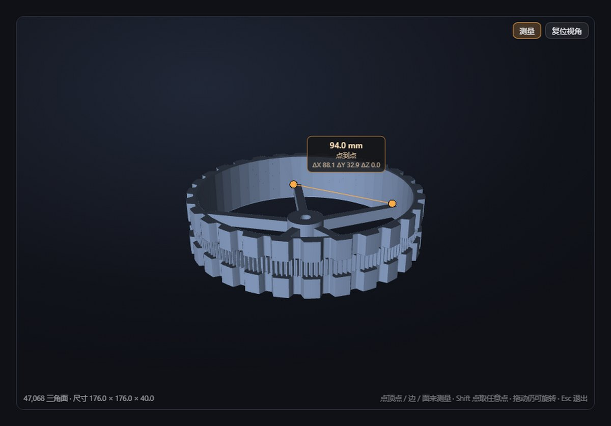
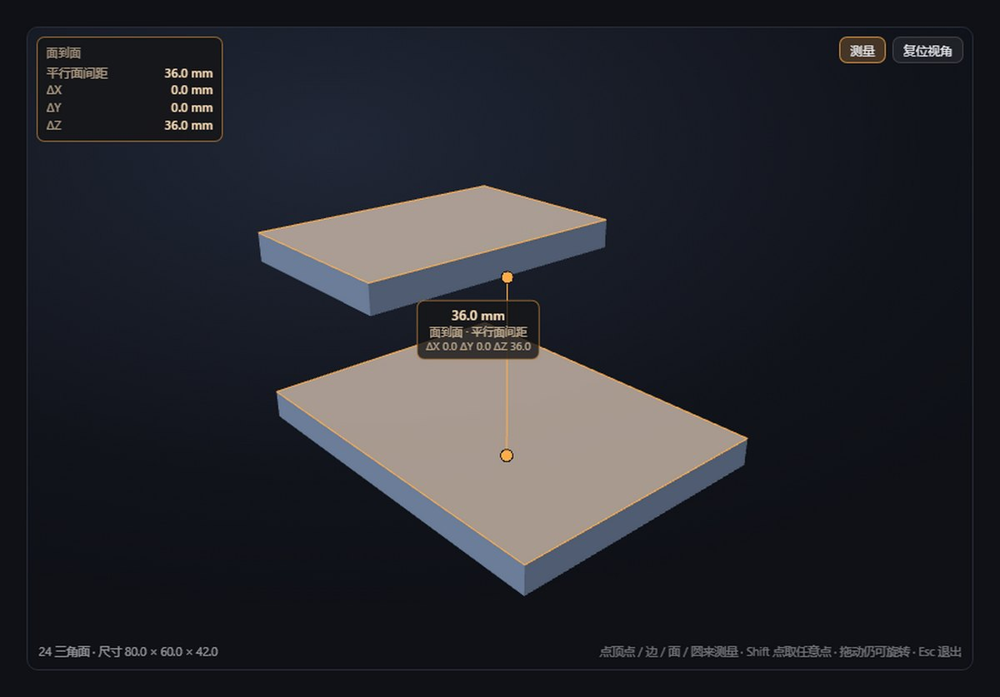
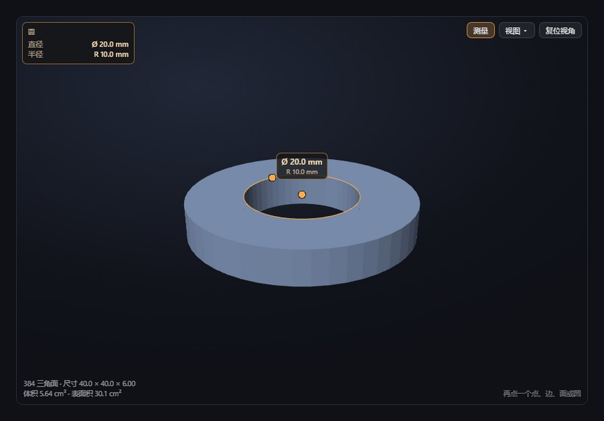
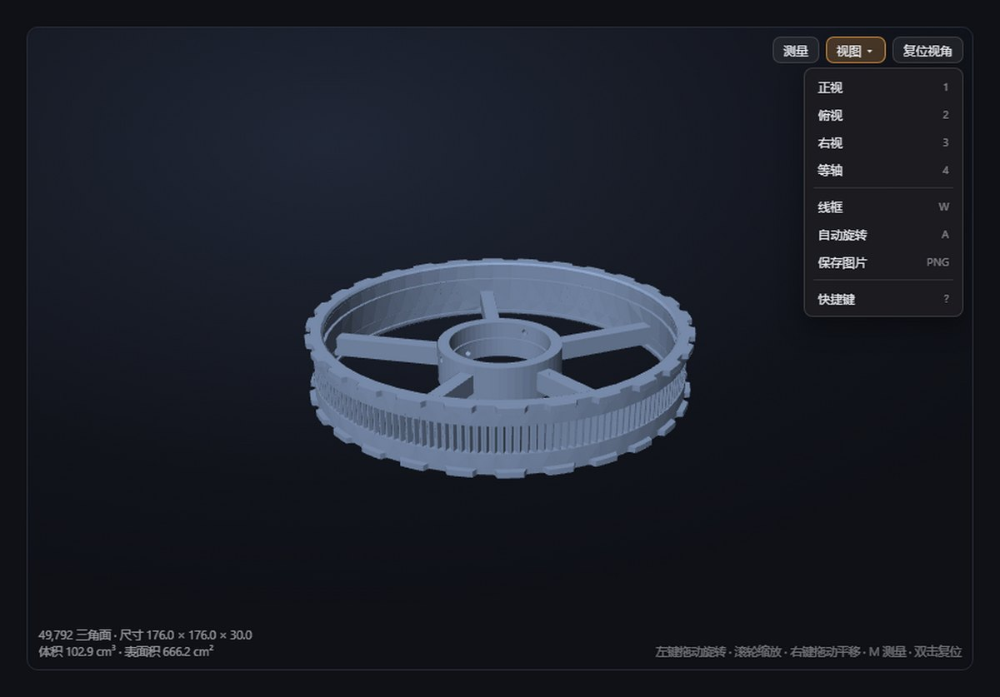
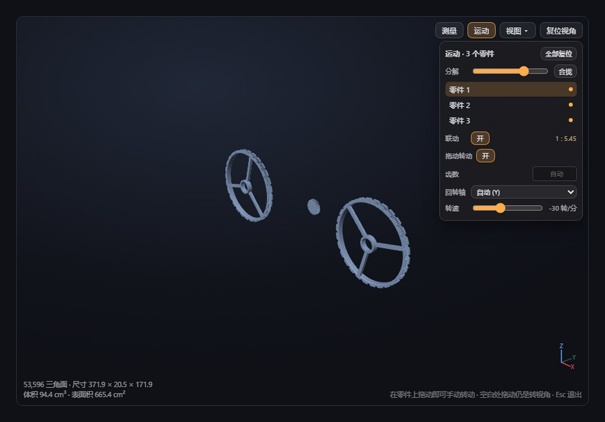
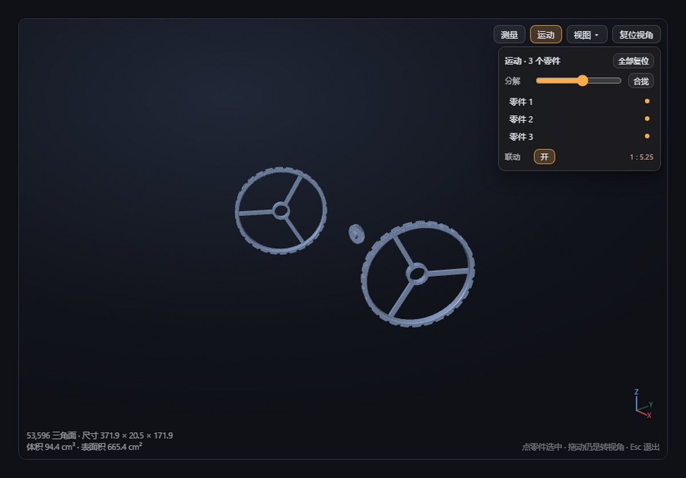
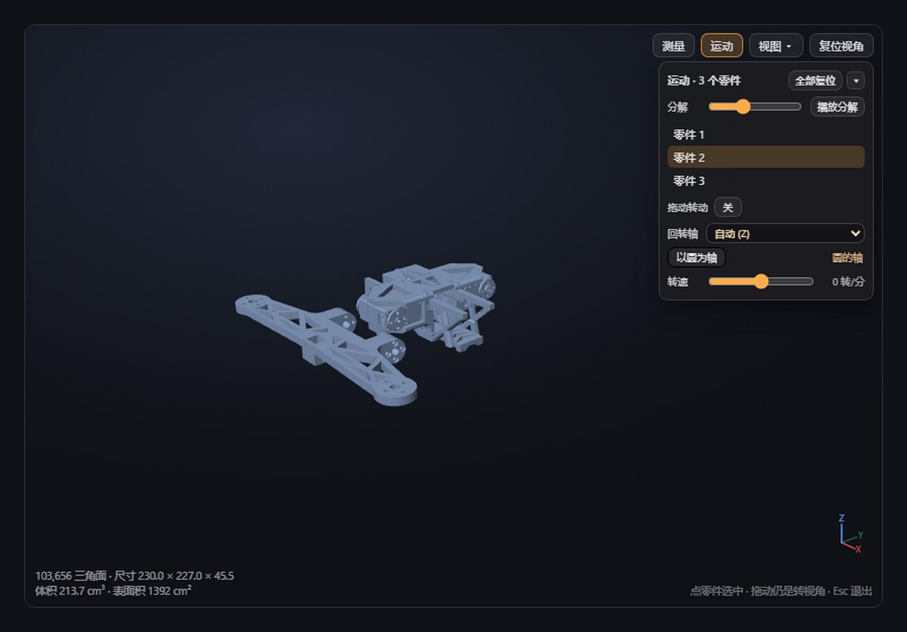

# dsh-stl-viewer

An **STL / STEP 3D preview** for the [DeepSeek Harness](https://github.com/deepseek-ai/dsh) side card.
Click any `.stl`, `.step`, `.stp`, `.iges`, `.igs` or `.brep` in the
[dsh-better-sidebar](https://github.com/H-h-Hh/dsh-better-sidebar) file tree and the file renders in
place, with the controls of a normal 3D viewer. STL is parsed in the page; STEP and the other B-rep
formats are tessellated by OpenCascade on the host, in a worker, and come back as the very same
triangles the rest of the plugin already knows how to draw, measure and weigh. An assembly keeps
its parts apart: explode it to see how it goes together, then spin any single part to watch
it turn, or grab it and drag it round by hand — and the gears find each other, so turning one
turns the ones it meshes with.

```
left-drag     orbit around the model — freely: the camera tumbles 360° in any direction,
              straight over the north pole and on under the model, with no gimbal stop
wheel         zoom
right-drag    pan (Shift + left-drag does the same; two-finger scroll zooms)
double-click  reset the view (the 复位视角 button and the R / 0 keys do too)

measure       click 测量 (or press M), then click two features — the cursor snaps to a
              vertex, an edge, a whole face or a circular rim, the way Bambu Studio's
              measure tool does. Shift-click takes an arbitrary point on the surface
              instead. Dragging still orbits, Esc or 测量 again leaves the mode

view          the 视图 menu holds front / top / right / iso (keys 1 / 2 / 3 / 4, animated),
              wireframe (W), turntable (A), the XYZ triad (G) and "save image" — plus a
              shortcut card (?)

motion        click 运动, then drag the 分解 slider to pull the parts apart (or press
              play and let it animate). Click a part in the list — or on the model — and
              give it a spin rate and an axis. Meshing gears are found for you and the 联动
              row passes the turn along; type the 齿数 of each gear to make the ratio exact.
              Turn on 拖动转动 to grab a part and turn it with the mouse instead — dragging
              empty space still orbits. 以圆为轴 takes the axis from the model itself: click a
              bore or a round edge and its centre becomes the hinge, its normal the axis. The ▾
              at the corner of the panel folds it down to its title so it stops covering the
              model. Esc or 运动 again leaves the mode

convert       a .step / .iges / .brep file is posted to the host, which tessellates it with
              OpenCascade in a worker; a small overlay counts the seconds and can cancel

language      the last row of the 视图 menu switches 中文 / English and remembers the
              choice. Until you pick one the panel follows the app language, and a
              Chinese system wins over an English app so the readouts stay readable
```

<p align="center">
  
</p>

<p align="center"><sub>A 47,068-triangle gear cover (176 × 176 × 40 mm) in the real side card, next to the chat that produced it.</sub></p>

<p align="center">
  
  
</p>

<p align="center"><sub>No viewer installed: “此文件类型不支持预览 / 下载查看”. With the plugin: a 2,912-triangle enclosure lid and a 17,136-triangle stencil, both in the side card.</sub></p>

<p align="center">
  
</p>

<p align="center"><sub>点到点: the cursor snaps to the corner you are aiming at, the picked point is drawn
as a dot on the model, and the readout carries the straight distance plus ΔX / ΔY / ΔZ: 58.0 mm
across the diagonal of a plate, the two farthest corners the test could find.</sub></p>

<p align="center">
  
</p>

<p align="center"><sub>面到面: click one face, then another. Coplanar triangles are flood-filled from the
picked one, so you measure a real face — not one triangle — and two parallel faces give the
gap between them: 36.0 mm here, with ΔX / ΔY / ΔZ underneath.</sub></p>

<p align="center">
  
</p>

<p align="center"><sub>圆: hover a rim and the whole rim is one pick — here the 20 mm bore of a
washer, with the 40 mm outer rim available as a second, separate pick. The panel in the
top-left corner gives Ø and R (and, while measuring, the pair type plus ΔX / ΔY / ΔZ), the
way Bambu Studio does it.</sub></p>

<p align="center">
  
</p>

<p align="center"><sub>视图: front / top / right / iso, wireframe, turntable, save image and the
shortcut card in one menu, with the model's volume, surface area and watertightness in the
bottom-left corner.</sub></p>

<p align="center">
  
</p>

<p align="center"><sub>STEP: this is <code>stencil_top.step</code>, opened the same way. A B-rep file
has no triangles in it — the host tessellated its surfaces with OpenCascade and the plugin drew
the result, all 17,136 of them, which is exactly the count the STL export of the same part gives.
Measuring, volume and the view menu work because what arrives is ordinary triangles.</sub></p>

<p align="center">
  
</p>

<p align="center"><sub>运动: the same assembly (53,596 triangles), 3 parts, pulled apart 70 % — the
wheels turn about the model's own Y axis, which is why the 回转轴 row reads <code>自动 (Y)</code>
and the blue Z of the triad points straight up. <code>拖动转动</code> is on, so a drag on a
part turns that part rather than the camera. Explode and rotation are baked into the vertex
buffers, so picking, measuring and the readouts keep working on the moved geometry.</sub></p>

<p align="center">
  
</p>

<p align="center"><sub>Gear train: the same assembly, exploded 70 %. The pinion drives both wheels, so the 联动
row reads <code>1 : 5.25</code> and one spin rate turns all three at the ratio the teeth imply — the
two wheels the same way, the pinion the other way round. Nothing in the file says “gear”; the
plugin finds the pairs by parallel axes and centre distance, and the 齿数 boxes turn that
estimate into the drawing's own numbers.</sub></p>

<p align="center">
  
</p>

<p align="center"><sub>以圆为轴: the arm is a 230 mm plate whose real hinge is a servo output shaft 25 mm
off its own centre, so the automatic axis (the thinnest side of its bounding box, here
<code>自动 (Z)</code>) cannot know it. Pick the part, press <code>以圆为轴</code> and click the
bore or the servo horn: the circle's centre becomes the hinge and its normal the axis, and the
part then turns about that line — the vertex-to-axis distance does not change by more than a
millionth while the arm swings 29 mm at its tip.</sub></p>

> **Why a separate plugin?**
> DeepSeek Harness ships previews for text, images, PDFs and Markdown. Binary CAD
> formats such as `.stl`, `.obj`, `.step` fall through to “this file type cannot be
> previewed”. This plugin registers an `stl` file viewer on the `betterSidebar`
> service, so `.stl` stops being an opaque blob — and it adds a host route so the
> same viewer can open the B-rep formats too.

## Features

- **STL, STEP, IGES and BREP** — STL is parsed in the page. The others are B-rep: there is no
  triangle to draw until someone tessellates the surfaces, so the bytes are posted to a host
  route, an OpenCascade WebAssembly build runs them in a `worker_threads` worker (the reader is
  synchronous and would otherwise freeze the whole Host), and the result comes back as a packed
  triangle buffer that the client decodes into the same pipeline STL uses. A 6 MB stencil:
  17,136 triangles in about ten seconds, then cached by SHA-1
- **Binary and ASCII STL** — sniffed, not guessed from the extension: exact `84 + 50·N`
  size match first, then an ASCII scan, then a tolerant binary pass for files with
  trailing bytes
- **Correct normals** — recomputed per facet; STLs in the wild carry zeroed or
  plainly wrong normals, and exported meshes often mix winding orders
- **Two-sided shading** — `gl_FrontFacing` flips the normal, so inverted facets still read
  as solid rather than a black hole
- **Z-up → Y-up** — CAD and 3D printing export Z-up; the viewer stands models upright
  instead of showing them lying on their back
- **Frame-fit camera** — the orbit distance is derived from the bounding sphere and the
  FOV, so a 0.6 mm thick stencil and a 300 mm part both fill the panel on open
- **360° free tumbling** — a drag accumulates a quaternion on top of the base orientation, so
  the camera rolls over the poles and straight under the model instead of stopping at ±83°.
  No gimbal wall, no flip at the zenith, no camera roll creeping in: the basis is rebuilt from
  the quaternion every frame and stays orthonormal, and the XYZ triad keeps agreeing with what
  is on screen
- **Measure the way a CAD tool does** — the pointer snaps to a **vertex**, an **edge** or a
  whole **face**, like [Bambu Studio's measure tool](https://wiki.bambulab.com/en/software/bambu-studio/measure):
  corners within 12 px win over edges within 8 px, which win over the face underneath, and
  Shift-click takes an arbitrary point instead. Only real creases snap (boundary edges, or
  neighbours more than 20° apart), so a finely tessellated cylinder does not turn into a
  field of snapping edges. The pair decides what is measured — point/point is the straight
  distance, point/face the perpendicular distance, edge/edge the angle plus the gap,
  face/face the plane gap when parallel and the true shortest distance plus the angle when
  not — and every readout carries ΔX / ΔY / ΔZ. Picking is a ray–triangle intersection
  against the real mesh, and the numbers come from the raw file coordinates rather than the
  normalised render space, so they are the same numbers you would measure in CAD
- **Circles are picked as circles** — a rim on a bore, a boss or a cylinder is a chain of very
  short creases, and edge snapping alone would only ever catch one facet of it. Hovering a
  rim therefore traces the loop and fits a circle to it, which turns the whole rim into a
  single pick: the 20 mm bore and the 40 mm outside of a washer are two separate features, so
  an inner and an outer diameter can be read on their own. Clicking **inside** the hole works
  the same way — the bore wall is one smooth region whose boundary is that circle, so you do
  not have to land on the rim itself. The fit rejects what is not round (a hexagon is not a
  circle) and a chain that does not close
- **A readout panel in the corner** — the picks are listed in the top-left corner the way
  Bambu Studio does it: `直径 Ø 20.0 mm` and `半径 R 10.0 mm` for a circle, the pair type and
  the distance for a measurement, with ΔX / ΔY / ΔZ underneath
- **Volume, surface and watertightness** — the corner readout also answers the first
  question a print checks: how much material is this, and is the mesh closed? Volume comes
  from the divergence theorem, area from the facet areas, and both are divided back out of
  the render normalisation, so they are the file's own numbers (`cm³` / `cm²` under the mm
  assumption). "Not closed" means some edge belongs to a single facet — a hole in the shell
- **Explode an assembly, spin one part** — a STEP file that holds several solids becomes several
  parts. Explode slides them apart along the direction from the origin to each part's centre, and
  any part can be given a rotation rate and an axis. Auto picks the part's thinnest side, measured
  in the model's own frame rather than the renderer's: CAD puts Z up, the viewer rotates the
  geometry to Y-up, and mixing the two is how an “auto” axis ends up pointing sideways. A wheel
  therefore turns about its shaft, and a plate about its normal. The transform is baked into the
  positional and normal buffers and only the changed part is re-uploaded with `bufferSubData`, so
  hit-testing, measuring, wireframe and the volume readout all see the geometry where it
  currently is
- **A panel that folds away** — the motion panel is the one overlay that wants to stay open while
  you look at the model, so it folds: the ▾ next to the title drops everything but the title row,
  which is 30 px tall instead of 270. The fold survives while you stay in 运动 and opens again
  when you come back, and every control in it is drawn on a fixed dark surface with its own text
  colour, so a light app theme cannot turn the labels into dark-on-dark
- **A gear train that turns itself** — two parts count as meshed when their axes are parallel,
  they overlap along that axis by a real fraction of their thickness, and the distance between
  the axes is the sum of the radii measured where they overlap. That is enough to find the pair
  a CAD assembly never bothers to record: the ratio comes from the same radii, the direction
  flips because an external mesh turns the other way, and one spin rate then propagates along
  the whole train. Radii are read off a tessellation, so the estimate is a few percent off when
  a part carries more than one rim — type the tooth counts (168 / 168 / 32 here) and the ratio
  becomes exact, `1 : 5.25`. The 联动 row switches the whole thing off when you want to turn a
  single part on its own
- **Turn a part by hand** — with 拖动转动 switched on, dragging across a part rotates it about its
  axis instead of orbiting the camera; the grab point follows the surface, so the part does not
  slide out from under the cursor. The angle is whatever the drag is worth where your finger is:
  the tangential direction of the turn is projected into the screen and the drag is fitted to it,
  which also makes dragging backwards turn it back. With 联动 on, the parts it meshes with follow
  at the train's ratio, so hand-cranking one gear cranks the whole train
- **Any axis, not just X/Y/Z** — the row under 回转轴 takes the hinge from the model:
  press 以圆为轴, click a bore or a round edge, and that circle's centre becomes the pivot while
  its normal becomes the axis. Click a flat face instead and the plugin looks at that face's own
  circular boundaries and takes the one nearest your click, so clicking the plate around a hole
  works too. Esc leaves the picker before it leaves the mode, the row marks `圆的轴` once a
  circle is in use, and the automatic choice (a bounding-box measurement) is only a fallback
- **Standard views, animated** — front / top / right / iso on keys `1`–`4`, with a 260 ms
  eased transition that moves the orbit angles only, so your zoom and focus point survive
- **Wireframe and turntable** — `W` and `A`, or the same rows in the view menu. Wireframe
  draws the triangle edges over a dimmed solid (with polygon offset, so the lines do not
  z-fight), which is how you see how a model was tessellated
- **Save the picture** — the current frame as a PNG named after the file. It is drawn on
  demand before `toDataURL`, not grabbed from a stale buffer
- **An XYZ triad** — bottom right, red / green / blue, drawn as SVG so the letters stay
  crisp: it turns with the camera, dims the axis pointing away from you, and draws the axis
  pointing at you as a ring. The letters follow the *model's* axes, so for a Z-up CAD part
  blue Z points up on screen — the viewer rotates the geometry Z-up → Y-up internally, and
  the triad undoes that rotation before drawing. `G` or the view menu hides it
- **Chinese or English, and the Chinese one uses a Chinese face** — every label goes through
  one dictionary, and the last row of the 视图 menu flips it and stores the choice in
  `localStorage`. With no stored choice the panel follows the app: a `zh-CN` page means
  Chinese, and an English page on a Chinese system still means Chinese, because reading an
  English UI does not mean wanting English readouts. The chrome also carries an explicit
  Chinese-first `font-family`, so the panel keeps its glyphs even when the container it is
  dropped into uses a mono or Latin-only stack
- **Menus, not a button wall** — three buttons stay on the model, the 视图 menu holds the
  rest, and `?` opens a card listing every gesture and key
- **Themed** — transparent clear colour and `currentColor` chrome, so the panel follows
  the app's dark/light theme instead of stamping a white box on it
- **No build step, no dependencies** — `lib/client.js` *is* the artifact

## Requirements

- DeepSeek Harness `>= 0.2.0`
- [dsh-better-sidebar](https://github.com/H-h-Hh/dsh-better-sidebar) `>= 0.32.0` — it owns
  the file tree, the tabs and the `betterSidebar` service this plugin registers into. The
  client half declares `inject: ['betterSidebar']`; from Cordis 0.32 on, reading a service
  without declaring it throws, and an `apply` that swallows that error registers nothing at
  all — which is exactly how an older build of this plugin went silent after a DSH update
- A browser with WebGL 1 (everything current; the software rasteriser is enough)
- For STEP / IGES / BREP nothing else is needed: the host half pulls in
  [`occt-import-js`](https://www.npmjs.com/package/occt-import-js), OpenCascade compiled to
  WebAssembly, as its one dependency

## Install

In DSH, or from the plugin manager page → *install from a local directory*:

```
plugin_manager install_bundle  target: file:D:/path/to/dsh-stl-viewer
```

Then reload the page. Open any `.stl` or `.step` from the file tree; if the file is already
open in a tab as an unsupported binary, close that tab and click the file again.

Uninstall:

```
plugin_manager remove_bundle  target: dsh-stl-viewer
```

## How it works

The plugin is a bundle with a host half and a client half.

| half | file | what it does |
| --- | --- | --- |
| host | `lib/index.js` | registers `POST /dsh-stl-viewer/convert` on `ctx.webServer`, SHA-1s each body, serves repeats from an LRU cache and from a disk cache, and hands the rest to a resident worker |
| worker | `lib/convert.worker.mjs` | `occt-import-js` reads STEP / IGES / BREP, tessellates, and transfers back a packed triangle buffer |
| manifest | `package.json` | `dsh.bundle.patch` makes it a bundle, `exports["./client"]` + `dsh.client.platform: "web"` publish `/plugins/dsh-stl-viewer/client.js` |
| patch | `cordis.patch.yml` | the one `insert:` line that puts the plugin in the layer stack |
| client | `lib/client.js` | parse (or fetch the converted mesh) → normalise → WebGL → input → registration; a classic script, run by the DSH module loader, `require('react')` resolving to the host's React |

The host half mounts its routes inside `ctx.inject(['webServer'], …)`. Cordis refuses to read
`ctx.webServer` before the dependency is declared — and it throws at activation, not at call
time — while an object-level `inject` would defer the whole `apply()` until the service exists.
Wrapping just the mount block defers nothing else.

The viewer descriptor covers the extensions, one component for all of them:

Registration is one call, and the model bytes come from the sidebar's own route:

```js
ctx.betterSidebar.registerFileViewer({
  id: 'dsh-stl-viewer:stl',
  title: () => t('title'),
  icon: (size) => cubeIcon(size),
  exts: ['stl', 'step', 'stp', 'iges', 'igs', 'brep'],
  priority: 10,
  fetchStrategy: 'mediaUrl',   // the host hands over the raw-bytes URL
  component: StlViewer
})
```

`fetchStrategy: 'mediaUrl'` means the viewer gets `mediaUrl` as a prop and does a plain
`fetch()`, so no host RPC, no base64 over the wire. Everything after that is local:

| step | detail |
| --- | --- |
| read | `fetch(mediaUrl, { credentials: 'same-origin' })` → `ArrayBuffer` |
| parse | 80-byte header + `uint32` count + 50 bytes/facet, or `vertex x y z` triples (ASCII capped at 6 M numbers) |
| normalise | centre on the bbox, scale to a max edge of 2, per-facet normals, Z-up → Y-up |
| render | WebGL 1, three lights + specular, one `drawArrays`, redraws only on demand |

STEP takes one extra hop, and the rest is shared:

| step | detail |
| --- | --- |
| fetch | the same `mediaUrl` fetch — the sidebar's route already knows how to hand over the bytes |
| post | `POST plugins/dsh-stl-viewer/convert` with the bytes and an `x-dsh-stl-name` header (a relative URL, so a reverse-proxied Host works too) |
| tessellate | the host reads the body (128 MB cap), SHA-1s it, and runs OpenCascade in a resident worker with `linearDeflection: 0.0012` of the bounding box |
| pack | `'DSHM'` + version + triangle count + part count, then 9 float32 per triangle — 616 KB for the 17 k-triangle stencil above, instead of the 6 MB file |
| decode | header check, one `Float32Array` view, then the same `finalizeMesh`, so measuring, circles, volume and the view menu see ordinary geometry |

The plugin also registers a cube file icon for all six extensions, so the file tree stops
showing a generic blob.

## Notes and limits

- **Sizes carry no unit.** STL stores bare numbers; the `size X × Y × Z` readout is the
  raw bounding box, not mm or inch. A STEP file *does* declare a unit, so the converter is
  asked for millimetres and the numbers are real mm.
- **Volume and area inherit that assumption.** They are reported as `cm³` / `cm²`, i.e. the
  file's numbers read as mm. An inch-authored part will show numbers that are 16 387× off,
  which is the same caveat the measurement readout already carries.
- **"Closed" is about holes, not about manifoldness.** A mesh counts as closed when no edge
  belongs to just one facet. Edges shared by three or more facets (self-intersections,
  duplicated coplanar facets) do not make it "not closed", because there is no hole for
  resin or filament to leak through — they are a different kind of problem, and the viewer
  does not claim to find them.
- **Measurements say `mm`, because CAD STL almost always is.** The number is the raw
  coordinate distance in the file; if your model is authored in inches, read it as inches.
- **"A face" is a coplanar region, found by flood fill.** Curved surfaces are therefore many
  faces, which is what you want when measuring a flat pad against a plate, but a fillet is
  not a single face. Faces are grown along shared edges only, so a mesh with welded
  vertices gives the best regions.
- **The automatic axis is a measurement, not a hinge.** 「自动」picks the thinnest side of the
  part's bounding box in the model's own frame — right for a wheel or a flat plate, wrong for
  anything pinned at a point that is not its centre (an arm on a servo horn, a lid on a barrel
  hinge). 以圆为轴 exists for exactly that case: a real CAD assembly puts a bore right where the
  joint is, and the circle's centre and normal *are* the joint. A conical hole is fitted as a
  circle and refused when its radius wanders, so tapping a chamfer is not a risk.
- **Snapping needs the crease topology, which is built on first use.** Finding corners and
  creases means an edge sweep over the mesh — 0.6 s for 47 k facets — so it happens the first
  time you hover in measure mode instead of when the file opens. Meshes above 400 k facets
  skip it and fall back to face picking.
- **A circle is recognised, not assumed.** The rim must close (no turn sharper than 60° per
  step) and fit a circle within 2% of its radius, checked at the vertices, at the midpoint of
  every segment and against the rim plane — a 48-sided bore reads as round, a hexagon does not.
  Circles ride on the same crease topology as snapping, so they also wait for that first hover.
  The wall of a hole is treated as a circle too: it is grown as one smooth patch (across every
  edge that is not a crease), and its boundary has to be a circle whose axis the patch's own
  facets face sideways; a flat disc has both boundaries round but faces along the axis, so it
  stays a face. Small openings in that wall do not spoil it — a set-screw hole breaks the bore
  into a ring with two big and two little loops, so the widest group of equal radii wins and the
  patch still has to be a true cylinder (every vertex within 2% of one radius)
- **Z-up is assumed.** Models authored Y-up will lie on their side. Axis guessing is
  deliberately left out — a wrong guess is more confusing than a predictable default.
- **Large files are parsed whole.** A few hundred thousand facets take 1–2 s and one
  `drawArrays` call; there is no streaming and no LOD.
- **STEP is tessellated on the host, once per file.** The time is OpenCascade parsing the B-rep
  and building its topology — roughly 1.2–2 s per megabyte, single-threaded, and tessellation
  settings only change the triangle count, not the wait (a 6 MB stencil: 12.8 s at any
  deflection). So the wait is made to happen once: a progress overlay counts the seconds and
  offers cancel, the converter runs in a worker kept alive across requests, and every finished
  mesh is cached by SHA-1 in memory (8 files / 192 MB) **and on disk** in
  `%TEMP%/dsh-stl-viewer-cache` (24 files / 512 MB), so reopening a file — even after a DSH
  restart — is instant. Measured on the 6 MB stencil: 12.5 s cold, 6 ms from memory, 8 ms from
  disk. Detail is relative to the bounding box, which is what keeps a 0.6 mm stencil and a
  300 mm part both sensible — but it also means a huge assembly comes out coarse.
- **A big assembly is a long wait, and the budget now grows with it.** The wait is not
  linear in the file size: a 6 MB stencil takes 12.5 s, but a 121 MB eleven-part assembly was
  still parsing after 25 minutes, with one core pinned and 812 MB resident the whole time.
  So the timeout is no longer a flat ten minutes — it is `max(10 min, 20 s per MB)`, which is
  39 minutes for that file — and the overlay names the size and warns that a quarter of an
  hour is possible. Walking away now really stops the work: the host watches the request
  socket and answers `499` instead of finishing a mesh nobody will look at. For something
  that size the practical route is to save it as STL from the CAD tool, which this window
  parses in seconds, or to let it run once — the mesh is then on disk, and every later open
  is instant. Even with that budget a file can come back empty: that same 121 MB assembly was
  read for 55 minutes and then yielded no triangles at all — OpenCascade ended up with shapes it
  could not tessellate — so the panel now says so in plain words instead of showing the raw JSON
  error. If that happens to you, the file needs a different export, not a longer wait.
- **What arrives from STEP is triangles, not surfaces.** Measuring, circles and the volume
  readout work on the tessellation, exactly as they do for STL: a bore is a bore because the
  fitted rim really is round, not because the STEP says `CYLINDRICAL_SURFACE`.
- **A part is one solid OpenCascade hands back, and its name is a placeholder.** STEP files carry
  a name per product, but the tessellator's mesh names are things like `Open CASCADE STEP
  translator 7.9 1.1`, so the panel says 零件 1, 零件 2 … and keeps the original string as a
  tooltip. An STL has no parts at all: the whole file is one, so exploding it would do nothing
  and the slider stays at zero — it can still be given a spin rate.
- **Motion is frozen while measuring.** Measuring builds edge, corner and circle topology from the
  vertex positions; a spinning part would invalidate it every frame, so entering measure mode stops
  every spin and collapses nothing else, and the topology is rebuilt on the next hover.
- **The auto axis is a measurement, not a label.** It is the part's thinnest bounding-box side in
  model space, which is right for wheels, plates and turned parts but meaningless for a shaft
  lying diagonally; the axis box next to it overrides the guess with X / Y / Z. Hand-turning sets
  that part's rate to zero, so what you put where you left it stays there.
- **A meshed pair is recognised, not declared.** Offsets, backlash and a profile-shifted gear all
  blur the radii, so the ratio found from geometry is an estimate — it reads `1 : 5.45` on a
  168-tooth wheel that a Ø172 walking rim makes look 86 mm in radius, where the drawing says
  `1 : 5.25`. Tooth counts win when they are filled in: same module means the ratio is the
  inverse ratio of the tooth counts, and the geometry is only the fallback
- `.obj`, `.glb`, `.3mf` are out of scope.
- **No WebGL → a message, not a white panel.**

## Tests

```bash
npm install            # only dependency: occt-import-js, used by the host half
node --check lib/client.js
node test/smoke.cjs    # client, in a vm sandbox, no browser
node test/host.mjs     # host routes, real OpenCascade, real STEP fixture
```

`test/smoke.cjs` runs `lib/client.js` in a `vm` sandbox with a minimal React hooks stub and
a replaceable `fetch`, and asserts the module contract, the viewer descriptor, a
hand-built binary cube (12 facets, size 20), an ASCII single triangle, the three
error paths (garbage bytes, empty file, failed fetch), the face-to-face geometry —
plane fitting, point-to-triangle and triangle-to-triangle distance — and the feature
topology: 8 corners and exactly 12 creases on a cube (the 6 in-plane diagonals do not
count), plus point/segment/plane helpers. The circle fit gets its own group: a 24-gon traces
back to its start and fits r = 10, a hexagon, a square and an open chain are all rejected,
and a washer fixture yields exactly two rims, R10 and R20. The last group checks the model
stats against arithmetic: the 20 mm cube fixture is 8000 mm³ and 2400 mm², the washer matches
π(R² − r²)h within the polygonal approximation, the two plates add up to 43200 mm³, and a
single triangle has area but no volume and is not closed. The last group is the STEP plumbing:
the five extensions are recognised, a hand-packed `'DSHM'` buffer decodes back to 18 floats, the
decoded mesh reads as a 10 mm square of 100 mm², and a foreign magic number is rejected. One last
group holds a 120 MB STEP conversion open and asserts the overlay says `120 MB`, warns that it may
take a quarter of an hour, and suggests saving it as STL instead. No browser needed.
`.github/workflows/test.yml` runs the same on every push.

`test/host.mjs` loads `lib/index.js` as a plain module with a fake Cordis context, captures the
two routes it registers, and drives them with Node-style request/response objects: the health
route reports the five formats, `GET` on the converter is a 405, the junk-bytes case comes back
as a JSON 500, and `test/fixtures/cube.step` — a 20 mm cube generated by
`test/fixtures/make-step.cjs` — round-trips through the real worker and OpenCascade as exactly
12 triangles, 20 × 20 × 20 mm and 8000 mm³, with the second request served from cache in under
200 ms. Two more cases pin the new behaviour: `conversionBudget` stays at ten minutes for a small
file and reaches 39 minutes for 116 MB, and a request whose socket is already destroyed comes back
as `499` without touching the converter.

The end-to-end check uses a real renderer: `test/harness.html` mounts the component with
React UMD builds, `test/shoot.cjs` screenshots it through a headless Electron
(`--enable-unsafe-swiftshader --use-gl=swiftshader`). That is how the images above
were produced.

`test/measure.cjs` drives the same harness with synthetic pointer events: it looks up the
screen pixels of the two plate faces through the viewer's `_test` handle, clicks 测量,
clicks both faces, and asserts the label reads `36.0 mm` with `面到面 · 平行面间距`, that
`_test.measure().parallel` is true, and that Esc clears everything again. The fixture
`test/fixtures/plates.stl` comes from `test/fixtures/make-plates.cjs`: two 80 x 60 mm
plates 36 mm apart, the top one covering half of the bottom one. The same fixture doubles as
the snapping check: `test/snap-points.cjs` scans the canvas for pixels that snap to a
`point`, picks the two farthest apart and asserts the label reads `58.0 mm` — the diagonal of
the top plate — with ΔX 40 / ΔY 0 / ΔZ 42.

`test/circle.cjs` covers the rims, on a washer made by `test/fixtures/make-ring.cjs` (Ø40
outside, Ø20 bore, 6 mm thick, 48 segments, normals written as zero so the plugin has to
recompute them). It sweeps the canvas through `_test.pickFeature`, keeps the pixels that snap
to a circle and asserts there are exactly two of them, then clicks the bore and reads the
corner panel: `直径 Ø 20.0 mm` and `半径 R 10.0 mm`.

`test/view.cjs` drives the view menu through its real DOM: it opens 视图, clicks 俯视 and
asserts the camera really is looking down (pitch 1.5607) with the zoom untouched, turns
wireframe on, starts and stops the turntable (checking the yaw moved while it ran), grabs a
snapshot and asserts the result is a PNG data URL, opens the shortcut card and closes it
again, presses `2` on the focused canvas and expects the same top view, and finally drags the
canvas 400 px upwards with synthetic pointer events: the camera must end up **under** the model
(`dir[1] < -0.3`), the triad must still read X / Y / Z, and dragging back must return to the
starting direction — the free-tumble regression. The same run checks the triad against the
model axes: looking straight down, the blue Z line must collapse into a ring
(`axisTopZFlat`), while red X still goes right and green Y goes up the screen.

```bash
env -u ELECTRON_RUN_AS_NODE -u NODE_OPTIONS <electron> test/measure.cjs \
  "test/harness.html?file=./fixtures/plates.stl" out.png
env -u ELECTRON_RUN_AS_NODE -u NODE_OPTIONS <electron> test/snap-points.cjs \
  "test/harness.html?file=./fixtures/plates.stl" out.png
env -u ELECTRON_RUN_AS_NODE -u NODE_OPTIONS <electron> test/circle.cjs \
  "test/harness.html?file=./fixtures/ring.stl" out.png
env -u ELECTRON_RUN_AS_NODE -u NODE_OPTIONS <electron> test/view.cjs \
  "test/harness.html?file=./fixtures/ring.stl" out.png
env -u ELECTRON_RUN_AS_NODE -u NODE_OPTIONS <electron> test/hub.cjs \\
  "test/harness.html?file=./some/real/part.stl" out.png 47
```

`test/hub.cjs` is the regression for bores that are not clean: the last argument is the
diameter to look for in mm, and it clicks every circle it can find on a real part until one
answers with that Ø. It needs a model of your own, so it stays out of CI.

`test/step.cjs` is the end-to-end for the new formats, and the only test that uses the real
host: it starts an HTTP server inside the Electron main process that serves the harness and
the plugin's own convert handler, loads the page over `http://`, lets the viewer fetch the
STEP bytes and post them back to the host, and then reads the corner readout. With the fixture
cube it asserts 12 triangles and 8.00 cm³; pointed at a real 6 MB part it reports 17,136
triangles — the same count that part's STL export gives.

```bash
env -u ELECTRON_RUN_AS_NODE -u NODE_OPTIONS <electron> test/step.cjs out.png ./fixtures/cube.step
env -u ELECTRON_RUN_AS_NODE -u NODE_OPTIONS <electron> test/step.cjs out.png ./_your_part.step
```

The second form is how the STEP screenshot above was made: copy a model into `test/` (the
harness serves that directory) and pass it as a relative path.

`test/motion.cjs` is the assembly end-to-end. It runs the real harness against the real host
converter, opens 运动, checks that a click on the model selects the part under the cursor, then
switches 拖动转动 on, drags 80 px across a part and asserts the part's angle changed while the
camera did not, switches it off and asserts the same drag now orbits. It then drags the explode
slider and asserts the vertex buffer actually moved, gives a part 60 rpm, waits and reads the
angle back, switches the axis to Z, folds the panel down to its title and asserts the body is
gone and the panel shrank from 268 px to 30 px, unfolds it, reads back the computed colours of
the axis dropdown (cream on near-black, so it is legible whatever the OS draws native controls
with), resets everything, and closes the panel with Esc.
Typical output on the three-part gear fixture: `parts: 3`, `autoAxes: [1,1,1]` (all three wheels
turn about model Y), `clickSelects: true`, `turned: true`, `cameraStayed: true`, `orbitWhenOff:
true`, `moved: 0.71`, `spun: 4.40` radians. It needs Electron, so it stays out of CI.

```bash
env -u ELECTRON_RUN_AS_NODE -u NODE_OPTIONS <electron> test/motion.cjs \
  "test/harness.html?file=./fixtures/cube.step" out.png
env -u ELECTRON_RUN_AS_NODE -u NODE_OPTIONS <electron> test/motion.cjs \
  "test/harness.html?file=./_your_assembly.step" out.png
```

`test/couple.cjs` is the gear-train end-to-end. It tessellates a real assembly, reads the pairs the
plugin found, turns the pinion at one revolution per second, waits and compares the angles of the
three parts: the two wheels must turn together, the pinion the other way, and the ratio must match
the geometry. Then it types the tooth counts and asserts the ratio becomes exactly 5.25, switches
联动 off and checks the wheels stand still, switches it back on and checks they move again. Typical
output on the three-part gear fixture: `ratioMeasured: 5.452`, `withTeeth.ratio: 5.25`,
`uncoupled.wheelsStill: true`.

```bash
env -u ELECTRON_RUN_AS_NODE -u NODE_OPTIONS <electron> test/couple.cjs out.png ./_your_assembly.step
```

`test/hinge.cjs` is the axis-from-a-circle end-to-end. It opens a model through the real converter
route, enters 运动, selects a part, presses 以圆为轴 and checks that clicking again leaves the
picker (Esc) — then it either clicks a circle it found by scanning the frame or, on a big assembly
where the horns are only a few pixels wide, clicks anywhere on the part and lets the face fallback
choose a bore. Either way it samples a few dozen vertices before and after a turn and asserts that
every vertex stayed the same distance from the chosen axis: `worstRadiusDrift` comes out at 1e-7 or
less over a 230 mm part. Run it with `GRID=0.05` on a dense model to make the circle scan finer.

```bash
env -u ELECTRON_RUN_AS_NODE -u NODE_OPTIONS <electron> test/hinge.cjs out.png ./fixtures/ring.stl 0
env -u ELECTRON_RUN_AS_NODE -u NODE_OPTIONS GRID=0.05 <electron> test/hinge.cjs out.png ./_your_assembly.step 1
```

## 中文速览

给 DSH 侧边栏加一个 **STL / STEP 三维预览**：文件树里点开 `.stl`、`.step`、`.stp`、`.iges`、`.igs`、`.brep`，右侧面板直接渲染，交互同常规 3D 看图。

```bash
plugin_manager install_bundle  target: file:D:/path/to/dsh-stl-viewer
```

- 左键旋转，**可 360° 自由翻滚**：一路拖过天顶翻到模型背面乃至底下，没有 ±83° 的极点死角、过顶也不会突然翻转 / 滚轮缩放 / 右键平移 / 双击复位（`R`、`0` 也复位）
- 点「测量」（或按 `M`）后光标会像 Bambu Studio 那样吸附到**顶点 / 棱 / 面 / 圆**：两个点的直线距离、点到面的垂直距离、两棱的夹角与间距、两面平行取间距、不平行取夹角 + 最短距离、圆心距等，读数都带 ΔX/ΔY/ΔZ；`Shift` + 点击取任意表面点；拖动仍可旋转，`Esc` 退出
- 悬停圆孔/圆柱的边一圈即整圈选中，**内径与外径是两个独立的圆**可分别点；左上角面板显示 `直径 Ø` 与 `半径 R`，和 Bambu Studio 的读数面板一致
- 二进制与 ASCII STL 都能读；法线逐面重算、双面打光，Z-up 自动立起来
- **STEP / IGES / BREP**：B-rep 文件里根本没有三角面，字节会先 POST 给插件的宿主路由，由 OpenCascade（`occt-import-js`）在 worker 线程里三角化，再回传紧凑网格——遮罩上显示转换秒数、可取消。慢的是 OpenCascade 解析 B-rep：约每 MB 1.2–2 秒，且与三角化参数无关（6 MB 的钢网无论怎么调都是 12.8 秒）。所以只让它算一次：worker 常驻复用，结果按 SHA-1 缓存在内存（8 个 / 192 MB）和 `%TEMP%/dsh-stl-viewer-cache`（24 个 / 512 MB），重开同一文件甚至重启 DSH 后都是秒开——实测冷 12.5 秒、内存 6 ms、磁盘 8 ms。6 MB 钢网得到 17,136 个三角面，与同零件的 STL 导出完全一致。等待时间随文件放大：超时取 `max(10 分钟, 每 MB 20 秒)`，所以 121 MB 的装配体有 39 分钟预算，遮罩上会写出体积、提醒可能要十几分钟；关掉面板/刷新页面会真的把 worker 停下（宿主回 499），不会白算下去。也有可能等完了却一个面都没有（实测那份 121 MB 的装配体读了 55 分钟后 OpenCascade 没给回任何三角面，面板会直说“没有可三角化的实体”），那不是慢的问题，是导出方式的问题。那么大的文件更实用的做法是在 CAD 里另存 STL——本机几秒就解析完——或者让它算一次，之后磁盘缓存秒开
- **装配体运动**（`运动`）：STEP 里的每个实体算一个零件，拖「分解」把它们沿各自方向散开（带 900 ms 缓动，相机自动退到能看全的位置）；点零件行或直接在模型上点，就能给它单独设**转速**（每分钟转数）和**回转轴**。「自动」取的是**模型自己坐标系里**最薄的一个方向（CAD 里 Z 向上，渲染时几何被转成 Y-up，两套坐标混用就会让「自动」指到侧面去）：轮子绕轮轴转、板子绕法线转，面板上会写成 `自动 (Y)` 这样。「拖动转动」开着时，在零件上拖就是手动转它（空白处拖仍是转视角），抓住点跟着表面走，手指不会从零件上滑开；联动开着时齿链上的邻居按传动比跟着转。面板右上角的 ▾ 可把它折叠成一行（约 30 px），不再挡住模型；面板是固定深色面，字色自带，浅色主题下也不会变成深色字变换是直接烘进顶点与法线的（只对改动的零件 `bufferSubData`），所以拾取、测量、线框、体积读数都跟着走动。进测量模式会先冻结所有转动并重建拓扑
- **齿轮联动**：只要两根轴平行、轴向真有重叠、轴距约等于两处半径之和，就认作一对齿合（STEP 里没有“齿轮”这种东西，全靠几何推），转速按半径反比传递、外齿合反向，「联动」一行显示 `1 : 5.25` 这样的传动比，一个转速就能带动整列车。半径是从三角面量出来的，遇到一个零件带多层齿圈会差几个百分点；面板里的「齿数」填上（这里是 168 / 168 / 32）就按同模数的齿数反比算，精确到 `1 : 5.25`
- **以圆为轴**：自动轴只是“包围盒最薄的那一边”，机臂这种铰链不在自身中心的零件会转错地方。选中零件后点「回转轴」下面的 `以圆为轴`，再点一下模型上的圆孔或圆边——那个圆的圆心就是铰链、法线就是轴（点平面也行：会在这块面自己的圆边里挑离点击处最近的一个）。`Esc` 先退出选圆再退出运动模式，装上之后那一行会显示 `圆的轴`，换回 X/Y/Z 或「自动」就恢复
- 相机按包围球自适应，0.6 mm 的钢网和 300 mm 的零件都会铺满面板
- 「视图」菜单：正视 / 俯视 / 右视 / 等轴（`1`–`4`，260 ms 缓动过渡，缩放保持不变）、线框（`W`）、自动旋转（`A`）、坐标轴（`G`）、保存当前画面为 PNG，以及 `?` 快捷键卡片
- 右下角有红/绿/蓝 **XYZ 三脚标**：跟着相机转，背向你的轴压暗，正对你的轴画成圆环；用 SVG 画所以字始终清晰，`G` 可关。字母标的是**模型自己的轴**——零件在 CAD 里 Z 向上，屏幕上就是蓝 Z 朝上（渲染时几何被转成 Y-up，三脚标画之前会把这步转回去）
- 界面中英双语：`视图` 菜单最后一行切 `语言`，选择记在 `localStorage` 里；没选过就跟随应用语言——应用是英文但系统是中文时也用中文。面板本身带一条中文优先的字体栈，放进纯拉丁或等宽字体的容器里也不会掉成宋体
- 左下角除三角面数与尺寸外，还给**体积 / 表面积**和是否闭合（有破面标「未闭合」），数字按文件自身的坐标算
- 依赖 dsh-better-sidebar ≥ 0.32.0：客户端半侧声明 `inject: ['betterSidebar']`。Cordis 0.32 起，不声明就去读服务会抛 `cannot get property … without inject`，而这个错误被 `apply` 里的 try/catch 吞掉了 —— 这正是旧版在 DSH 更新后整个预览器静默失效的原因。没有构建步骤，`lib/client.js` 就是产物

尺寸没有单位（STL 不存单位；STEP 自带单位，转换时按毫米要），STL 大文件整体解析（几十万面约 1–2 秒）；B-rep 的耗时按体积给预算、可取消，`.obj/.glb/.3mf` 不在范围内。

## License

MIT — see [LICENSE](LICENSE).
