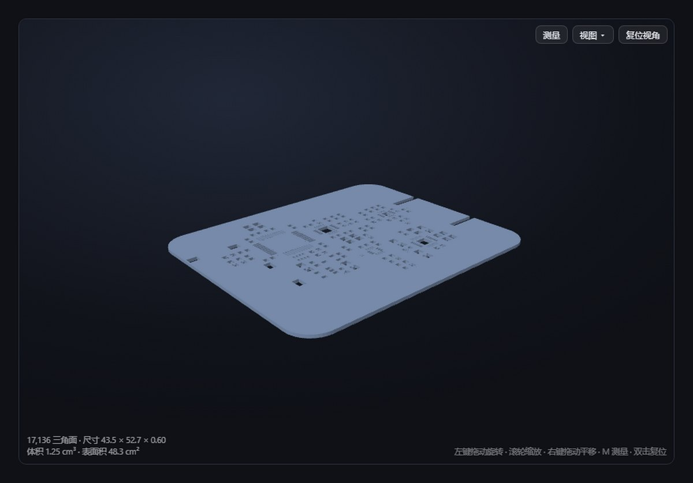

# dsh-stl-viewer

An **STL / STEP 3D preview** for the [DeepSeek Harness](https://github.com/deepseek-ai/dsh) side card.
Click any `.stl`, `.step`, `.stp`, `.iges`, `.igs` or `.brep` in the
[dsh-better-sidebar](https://github.com/H-h-Hh/dsh-better-sidebar) file tree and the file renders in
place, with the controls of a normal 3D viewer. STL is parsed in the page; STEP and the other B-rep
formats are tessellated by OpenCascade on the host, in a worker, and come back as the very same
triangles the rest of the plugin already knows how to draw, measure and weigh.

```
left-drag     orbit around the model
wheel         zoom
right-drag    pan (Shift + left-drag does the same; two-finger scroll zooms)
double-click  reset the view (the 复位视角 button and the R / 0 keys do too)

measure       click 测量 (or press M), then click two features — the cursor snaps to a
              vertex, an edge, a whole face or a circular rim, the way Bambu Studio's
              measure tool does. Shift-click takes an arbitrary point on the surface
              instead. Dragging still orbits, Esc or 测量 again leaves the mode

view          the 视图 menu holds front / top / right / iso (keys 1 / 2 / 3 / 4, animated),
              wireframe (W), turntable (A), the XYZ triad (G) and "save image" — plus a
              shortcut card (?)

convert       a .step / .iges / .brep file is posted to the host, which tessellates it with
              OpenCascade in a worker; a small overlay counts the seconds and can cancel
```

<p align="center">
  
</p>

<p align="center"><sub>A 47,068-triangle gear cover (176 × 176 × 40 mm) in the real side card, next to the chat that produced it.</sub></p>

<p align="center">
  
  
</p>

<p align="center"><sub>No viewer installed: “此文件类型不支持预览 / 下载查看”. With the plugin: a 2,912-triangle enclosure lid and a 17,136-triangle stencil, both in the side card.</sub></p>

<p align="center">
  
</p>

<p align="center"><sub>点到点: the cursor snaps to the corner you are aiming at, the picked point is drawn
as a dot on the model, and the readout carries the straight distance plus ΔX / ΔY / ΔZ: 58.0 mm
across the diagonal of a plate, the two farthest corners the test could find.</sub></p>

<p align="center">
  
</p>

<p align="center"><sub>面到面: click one face, then another. Coplanar triangles are flood-filled from the
picked one, so you measure a real face — not one triangle — and two parallel faces give the
gap between them: 36.0 mm here, with ΔX / ΔY / ΔZ underneath.</sub></p>

<p align="center">
  
</p>

<p align="center"><sub>圆: hover a rim and the whole rim is one pick — here the 20 mm bore of a
washer, with the 40 mm outer rim available as a second, separate pick. The panel in the
top-left corner gives Ø and R (and, while measuring, the pair type plus ΔX / ΔY / ΔZ), the
way Bambu Studio does it.</sub></p>

<p align="center">
  
</p>

<p align="center"><sub>视图: front / top / right / iso, wireframe, turntable, save image and the
shortcut card in one menu, with the model's volume, surface area and watertightness in the
bottom-left corner.</sub></p>

<p align="center">
  
</p>

<p align="center"><sub>STEP: this is <code>stencil_top.step</code>, opened the same way. A B-rep file
has no triangles in it — the host tessellated its surfaces with OpenCascade and the plugin drew
the result, all 17,136 of them, which is exactly the count the STL export of the same part gives.
Measuring, volume and the view menu work because what arrives is ordinary triangles.</sub></p>

> **Why a separate plugin?**
> DeepSeek Harness ships previews for text, images, PDFs and Markdown. Binary CAD
> formats such as `.stl`, `.obj`, `.step` fall through to “this file type cannot be
> previewed”. This plugin registers an `stl` file viewer on the `betterSidebar`
> service, so `.stl` stops being an opaque blob — and it adds a host route so the
> same viewer can open the B-rep formats too.

## Features

- **STL, STEP, IGES and BREP** — STL is parsed in the page. The others are B-rep: there is no
  triangle to draw until someone tessellates the surfaces, so the bytes are posted to a host
  route, an OpenCascade WebAssembly build runs them in a `worker_threads` worker (the reader is
  synchronous and would otherwise freeze the whole Host), and the result comes back as a packed
  triangle buffer that the client decodes into the same pipeline STL uses. A 6 MB stencil:
  17,136 triangles in about ten seconds, then cached by SHA-1
- **Binary and ASCII STL** — sniffed, not guessed from the extension: exact `84 + 50·N`
  size match first, then an ASCII scan, then a tolerant binary pass for files with
  trailing bytes
- **Correct normals** — recomputed per facet; STLs in the wild carry zeroed or
  plainly wrong normals, and exported meshes often mix winding orders
- **Two-sided shading** — `gl_FrontFacing` flips the normal, so inverted facets still read
  as solid rather than a black hole
- **Z-up → Y-up** — CAD and 3D printing export Z-up; the viewer stands models upright
  instead of showing them lying on their back
- **Frame-fit camera** — the orbit distance is derived from the bounding sphere and the
  FOV, so a 0.6 mm thick stencil and a 300 mm part both fill the panel on open
- **Measure the way a CAD tool does** — the pointer snaps to a **vertex**, an **edge** or a
  whole **face**, like [Bambu Studio's measure tool](https://wiki.bambulab.com/en/software/bambu-studio/measure):
  corners within 12 px win over edges within 8 px, which win over the face underneath, and
  Shift-click takes an arbitrary point instead. Only real creases snap (boundary edges, or
  neighbours more than 20° apart), so a finely tessellated cylinder does not turn into a
  field of snapping edges. The pair decides what is measured — point/point is the straight
  distance, point/face the perpendicular distance, edge/edge the angle plus the gap,
  face/face the plane gap when parallel and the true shortest distance plus the angle when
  not — and every readout carries ΔX / ΔY / ΔZ. Picking is a ray–triangle intersection
  against the real mesh, and the numbers come from the raw file coordinates rather than the
  normalised render space, so they are the same numbers you would measure in CAD
- **Circles are picked as circles** — a rim on a bore, a boss or a cylinder is a chain of very
  short creases, and edge snapping alone would only ever catch one facet of it. Hovering a
  rim therefore traces the loop and fits a circle to it, which turns the whole rim into a
  single pick: the 20 mm bore and the 40 mm outside of a washer are two separate features, so
  an inner and an outer diameter can be read on their own. Clicking **inside** the hole works
  the same way — the bore wall is one smooth region whose boundary is that circle, so you do
  not have to land on the rim itself. The fit rejects what is not round (a hexagon is not a
  circle) and a chain that does not close
- **A readout panel in the corner** — the picks are listed in the top-left corner the way
  Bambu Studio does it: `直径 Ø 20.0 mm` and `半径 R 10.0 mm` for a circle, the pair type and
  the distance for a measurement, with ΔX / ΔY / ΔZ underneath
- **Volume, surface and watertightness** — the corner readout also answers the first
  question a print checks: how much material is this, and is the mesh closed? Volume comes
  from the divergence theorem, area from the facet areas, and both are divided back out of
  the render normalisation, so they are the file's own numbers (`cm³` / `cm²` under the mm
  assumption). "Not closed" means some edge belongs to a single facet — a hole in the shell
- **Standard views, animated** — front / top / right / iso on keys `1`–`4`, with a 260 ms
  eased transition that moves the orbit angles only, so your zoom and focus point survive
- **Wireframe and turntable** — `W` and `A`, or the same rows in the view menu. Wireframe
  draws the triangle edges over a dimmed solid (with polygon offset, so the lines do not
  z-fight), which is how you see how a model was tessellated
- **Save the picture** — the current frame as a PNG named after the file. It is drawn on
  demand before `toDataURL`, not grabbed from a stale buffer
- **An XYZ triad** — bottom right, red / green / blue, drawn as SVG so the letters stay
  crisp: it turns with the camera, dims the axis pointing away from you, and draws the axis
  pointing at you as a ring. `G` or the view menu hides it
- **Menus, not a button wall** — three buttons stay on the model, the 视图 menu holds the
  rest, and `?` opens a card listing every gesture and key
- **Themed** — transparent clear colour and `currentColor` chrome, so the panel follows
  the app's dark/light theme instead of stamping a white box on it
- **No build step, no dependencies** — `lib/client.js` *is* the artifact

## Requirements

- DeepSeek Harness `>= 0.2.0`
- [dsh-better-sidebar](https://github.com/H-h-Hh/dsh-better-sidebar) `>= 0.30.0` — it owns
  the file tree, the tabs and the `betterSidebar` service this plugin registers into
- A browser with WebGL 1 (everything current; the software rasteriser is enough)
- For STEP / IGES / BREP nothing else is needed: the host half pulls in
  [`occt-import-js`](https://www.npmjs.com/package/occt-import-js), OpenCascade compiled to
  WebAssembly, as its one dependency

## Install

In DSH, or from the plugin manager page → *install from a local directory*:

```
plugin_manager install_bundle  target: file:D:/path/to/dsh-stl-viewer
```

Then reload the page. Open any `.stl` or `.step` from the file tree; if the file is already
open in a tab as an unsupported binary, close that tab and click the file again.

Uninstall:

```
plugin_manager remove_bundle  target: dsh-stl-viewer
```

## How it works

The plugin is a bundle with a host half and a client half.

| half | file | what it does |
| --- | --- | --- |
| host | `lib/index.js` | registers `POST /dsh-stl-viewer/convert` on `ctx.webServer`, SHA-1s each body, serves repeats from an LRU cache and from a disk cache, and hands the rest to a resident worker |
| worker | `lib/convert.worker.mjs` | `occt-import-js` reads STEP / IGES / BREP, tessellates, and transfers back a packed triangle buffer |
| manifest | `package.json` | `dsh.bundle.patch` makes it a bundle, `exports["./client"]` + `dsh.client.platform: "web"` publish `/plugins/dsh-stl-viewer/client.js` |
| patch | `cordis.patch.yml` | the one `insert:` line that puts the plugin in the layer stack |
| client | `lib/client.js` | parse (or fetch the converted mesh) → normalise → WebGL → input → registration; a classic script, run by the DSH module loader, `require('react')` resolving to the host's React |

The host half mounts its routes inside `ctx.inject(['webServer'], …)`. Cordis refuses to read
`ctx.webServer` before the dependency is declared — and it throws at activation, not at call
time — while an object-level `inject` would defer the whole `apply()` until the service exists.
Wrapping just the mount block defers nothing else.

The viewer descriptor covers the extensions, one component for all of them:

Registration is one call, and the model bytes come from the sidebar's own route:

```js
ctx.betterSidebar.registerFileViewer({
  id: 'dsh-stl-viewer:stl',
  title: () => t('title'),
  icon: (size) => cubeIcon(size),
  exts: ['stl', 'step', 'stp', 'iges', 'igs', 'brep'],
  priority: 10,
  fetchStrategy: 'mediaUrl',   // the host hands over the raw-bytes URL
  component: StlViewer
})
```

`fetchStrategy: 'mediaUrl'` means the viewer gets `mediaUrl` as a prop and does a plain
`fetch()`, so no host RPC, no base64 over the wire. Everything after that is local:

| step | detail |
| --- | --- |
| read | `fetch(mediaUrl, { credentials: 'same-origin' })` → `ArrayBuffer` |
| parse | 80-byte header + `uint32` count + 50 bytes/facet, or `vertex x y z` triples (ASCII capped at 6 M numbers) |
| normalise | centre on the bbox, scale to a max edge of 2, per-facet normals, Z-up → Y-up |
| render | WebGL 1, three lights + specular, one `drawArrays`, redraws only on demand |

STEP takes one extra hop, and the rest is shared:

| step | detail |
| --- | --- |
| fetch | the same `mediaUrl` fetch — the sidebar's route already knows how to hand over the bytes |
| post | `POST plugins/dsh-stl-viewer/convert` with the bytes and an `x-dsh-stl-name` header (a relative URL, so a reverse-proxied Host works too) |
| tessellate | the host reads the body (128 MB cap), SHA-1s it, and runs OpenCascade in a resident worker with `linearDeflection: 0.0012` of the bounding box |
| pack | `'DSHM'` + version + triangle count + part count, then 9 float32 per triangle — 616 KB for the 17 k-triangle stencil above, instead of the 6 MB file |
| decode | header check, one `Float32Array` view, then the same `finalizeMesh`, so measuring, circles, volume and the view menu see ordinary geometry |

The plugin also registers a cube file icon for all six extensions, so the file tree stops
showing a generic blob.

## Notes and limits

- **Sizes carry no unit.** STL stores bare numbers; the `size X × Y × Z` readout is the
  raw bounding box, not mm or inch. A STEP file *does* declare a unit, so the converter is
  asked for millimetres and the numbers are real mm.
- **Volume and area inherit that assumption.** They are reported as `cm³` / `cm²`, i.e. the
  file's numbers read as mm. An inch-authored part will show numbers that are 16 387× off,
  which is the same caveat the measurement readout already carries.
- **"Closed" is about holes, not about manifoldness.** A mesh counts as closed when no edge
  belongs to just one facet. Edges shared by three or more facets (self-intersections,
  duplicated coplanar facets) do not make it "not closed", because there is no hole for
  resin or filament to leak through — they are a different kind of problem, and the viewer
  does not claim to find them.
- **Measurements say `mm`, because CAD STL almost always is.** The number is the raw
  coordinate distance in the file; if your model is authored in inches, read it as inches.
- **"A face" is a coplanar region, found by flood fill.** Curved surfaces are therefore many
  faces, which is what you want when measuring a flat pad against a plate, but a fillet is
  not a single face. Faces are grown along shared edges only, so a mesh with welded
  vertices gives the best regions.
- **Snapping needs the crease topology, which is built on first use.** Finding corners and
  creases means an edge sweep over the mesh — 0.6 s for 47 k facets — so it happens the first
  time you hover in measure mode instead of when the file opens. Meshes above 400 k facets
  skip it and fall back to face picking.
- **A circle is recognised, not assumed.** The rim must close (no turn sharper than 60° per
  step) and fit a circle within 2% of its radius, checked at the vertices, at the midpoint of
  every segment and against the rim plane — a 48-sided bore reads as round, a hexagon does not.
  Circles ride on the same crease topology as snapping, so they also wait for that first hover.
  The wall of a hole is treated as a circle too: it is grown as one smooth patch (across every
  edge that is not a crease), and its boundary has to be a circle whose axis the patch's own
  facets face sideways; a flat disc has both boundaries round but faces along the axis, so it
  stays a face. Small openings in that wall do not spoil it — a set-screw hole breaks the bore
  into a ring with two big and two little loops, so the widest group of equal radii wins and the
  patch still has to be a true cylinder (every vertex within 2% of one radius)
- **Z-up is assumed.** Models authored Y-up will lie on their side. Axis guessing is
  deliberately left out — a wrong guess is more confusing than a predictable default.
- **Large files are parsed whole.** A few hundred thousand facets take 1–2 s and one
  `drawArrays` call; there is no streaming and no LOD.
- **STEP is tessellated on the host, once per file.** The time is OpenCascade parsing the B-rep
  and building its topology — roughly 1.2–2 s per megabyte, single-threaded, and tessellation
  settings only change the triangle count, not the wait (a 6 MB stencil: 12.8 s at any
  deflection). So the wait is made to happen once: a progress overlay counts the seconds and
  offers cancel, the converter runs in a worker kept alive across requests, and every finished
  mesh is cached by SHA-1 in memory (8 files / 192 MB) **and on disk** in
  `%TEMP%/dsh-stl-viewer-cache` (24 files / 512 MB), so reopening a file — even after a DSH
  restart — is instant. Measured on the 6 MB stencil: 12.5 s cold, 6 ms from memory, 8 ms from
  disk. Detail is relative to the bounding box, which is what keeps a 0.6 mm stencil and a
  300 mm part both sensible — but it also means a huge assembly comes out coarse.
- **What arrives from STEP is triangles, not surfaces.** Measuring, circles and the volume
  readout work on the tessellation, exactly as they do for STL: a bore is a bore because the
  fitted rim really is round, not because the STEP says `CYLINDRICAL_SURFACE`.
- `.obj`, `.glb`, `.3mf` are out of scope.
- **No WebGL → a message, not a white panel.**

## Tests

```bash
npm install            # only dependency: occt-import-js, used by the host half
node --check lib/client.js
node test/smoke.cjs    # client, in a vm sandbox, no browser
node test/host.mjs     # host routes, real OpenCascade, real STEP fixture
```

`test/smoke.cjs` runs `lib/client.js` in a `vm` sandbox with a minimal React hooks stub and
a replaceable `fetch`, and asserts the module contract, the viewer descriptor, a
hand-built binary cube (12 facets, size 20), an ASCII single triangle, the three
error paths (garbage bytes, empty file, failed fetch), the face-to-face geometry —
plane fitting, point-to-triangle and triangle-to-triangle distance — and the feature
topology: 8 corners and exactly 12 creases on a cube (the 6 in-plane diagonals do not
count), plus point/segment/plane helpers. The circle fit gets its own group: a 24-gon traces
back to its start and fits r = 10, a hexagon, a square and an open chain are all rejected,
and a washer fixture yields exactly two rims, R10 and R20. The last group checks the model
stats against arithmetic: the 20 mm cube fixture is 8000 mm³ and 2400 mm², the washer matches
π(R² − r²)h within the polygonal approximation, the two plates add up to 43200 mm³, and a
single triangle has area but no volume and is not closed. The last group is the STEP plumbing:
the five extensions are recognised, a hand-packed `'DSHM'` buffer decodes back to 18 floats, the
decoded mesh reads as a 10 mm square of 100 mm², and a foreign magic number is rejected. No
browser needed.
`.github/workflows/test.yml` runs the same on every push.

`test/host.mjs` loads `lib/index.js` as a plain module with a fake Cordis context, captures the
two routes it registers, and drives them with Node-style request/response objects: the health
route reports the five formats, `GET` on the converter is a 405, the junk-bytes case comes back
as a JSON 500, and `test/fixtures/cube.step` — a 20 mm cube generated by
`test/fixtures/make-step.cjs` — round-trips through the real worker and OpenCascade as exactly
12 triangles, 20 × 20 × 20 mm and 8000 mm³, with the second request served from cache in under
200 ms.

The end-to-end check uses a real renderer: `test/harness.html` mounts the component with
React UMD builds, `test/shoot.cjs` screenshots it through a headless Electron
(`--enable-unsafe-swiftshader --use-gl=swiftshader`). That is how the images above
were produced.

`test/measure.cjs` drives the same harness with synthetic pointer events: it looks up the
screen pixels of the two plate faces through the viewer's `_test` handle, clicks 测量,
clicks both faces, and asserts the label reads `36.0 mm` with `面到面 · 平行面间距`, that
`_test.measure().parallel` is true, and that Esc clears everything again. The fixture
`test/fixtures/plates.stl` comes from `test/fixtures/make-plates.cjs`: two 80 x 60 mm
plates 36 mm apart, the top one covering half of the bottom one. The same fixture doubles as
the snapping check: `test/snap-points.cjs` scans the canvas for pixels that snap to a
`point`, picks the two farthest apart and asserts the label reads `58.0 mm` — the diagonal of
the top plate — with ΔX 40 / ΔY 0 / ΔZ 42.

`test/circle.cjs` covers the rims, on a washer made by `test/fixtures/make-ring.cjs` (Ø40
outside, Ø20 bore, 6 mm thick, 48 segments, normals written as zero so the plugin has to
recompute them). It sweeps the canvas through `_test.pickFeature`, keeps the pixels that snap
to a circle and asserts there are exactly two of them, then clicks the bore and reads the
corner panel: `直径 Ø 20.0 mm` and `半径 R 10.0 mm`.

`test/view.cjs` drives the view menu through its real DOM: it opens 视图, clicks 俯视 and
asserts the camera really is looking down (pitch 1.5607) with the zoom untouched, turns
wireframe on, starts and stops the turntable (checking the yaw moved while it ran), grabs a
snapshot and asserts the result is a PNG data URL, opens the shortcut card and closes it
again, and finally presses `2` on the focused canvas and expects the same top view.

```bash
env -u ELECTRON_RUN_AS_NODE -u NODE_OPTIONS <electron> test/measure.cjs \
  "test/harness.html?file=./fixtures/plates.stl" out.png
env -u ELECTRON_RUN_AS_NODE -u NODE_OPTIONS <electron> test/snap-points.cjs \
  "test/harness.html?file=./fixtures/plates.stl" out.png
env -u ELECTRON_RUN_AS_NODE -u NODE_OPTIONS <electron> test/circle.cjs \
  "test/harness.html?file=./fixtures/ring.stl" out.png
env -u ELECTRON_RUN_AS_NODE -u NODE_OPTIONS <electron> test/view.cjs \
  "test/harness.html?file=./fixtures/ring.stl" out.png
env -u ELECTRON_RUN_AS_NODE -u NODE_OPTIONS <electron> test/hub.cjs \\
  "test/harness.html?file=./some/real/part.stl" out.png 47
```

`test/hub.cjs` is the regression for bores that are not clean: the last argument is the
diameter to look for in mm, and it clicks every circle it can find on a real part until one
answers with that Ø. It needs a model of your own, so it stays out of CI.

`test/step.cjs` is the end-to-end for the new formats, and the only test that uses the real
host: it starts an HTTP server inside the Electron main process that serves the harness and
the plugin's own convert handler, loads the page over `http://`, lets the viewer fetch the
STEP bytes and post them back to the host, and then reads the corner readout. With the fixture
cube it asserts 12 triangles and 8.00 cm³; pointed at a real 6 MB part it reports 17,136
triangles — the same count that part's STL export gives.

```bash
env -u ELECTRON_RUN_AS_NODE -u NODE_OPTIONS <electron> test/step.cjs out.png ./fixtures/cube.step
env -u ELECTRON_RUN_AS_NODE -u NODE_OPTIONS <electron> test/step.cjs out.png ./_your_part.step
```

The second form is how the STEP screenshot above was made: copy a model into `test/` (the
harness serves that directory) and pass it as a relative path.

## 中文速览

给 DSH 侧边栏加一个 **STL / STEP 三维预览**：文件树里点开 `.stl`、`.step`、`.stp`、`.iges`、`.igs`、`.brep`，右侧面板直接渲染，交互同常规 3D 看图。

```bash
plugin_manager install_bundle  target: file:D:/path/to/dsh-stl-viewer
```

- 左键旋转 / 滚轮缩放 / 右键平移 / 双击复位（`R`、`0` 也复位）
- 点「测量」（或按 `M`）后光标会像 Bambu Studio 那样吸附到**顶点 / 棱 / 面 / 圆**：两个点的直线距离、点到面的垂直距离、两棱的夹角与间距、两面平行取间距、不平行取夹角 + 最短距离、圆心距等，读数都带 ΔX/ΔY/ΔZ；`Shift` + 点击取任意表面点；拖动仍可旋转，`Esc` 退出
- 悬停圆孔/圆柱的边一圈即整圈选中，**内径与外径是两个独立的圆**可分别点；左上角面板显示 `直径 Ø` 与 `半径 R`，和 Bambu Studio 的读数面板一致
- 二进制与 ASCII STL 都能读；法线逐面重算、双面打光，Z-up 自动立起来
- **STEP / IGES / BREP**：B-rep 文件里根本没有三角面，字节会先 POST 给插件的宿主路由，由 OpenCascade（`occt-import-js`）在 worker 线程里三角化，再回传紧凑网格——遮罩上显示转换秒数、可取消。慢的是 OpenCascade 解析 B-rep：约每 MB 1.2–2 秒，且与三角化参数无关（6 MB 的钢网无论怎么调都是 12.8 秒）。所以只让它算一次：worker 常驻复用，结果按 SHA-1 缓存在内存（8 个 / 192 MB）和 `%TEMP%/dsh-stl-viewer-cache`（24 个 / 512 MB），重开同一文件甚至重启 DSH 后都是秒开——实测冷 12.5 秒、内存 6 ms、磁盘 8 ms。6 MB 钢网得到 17,136 个三角面，与同零件的 STL 导出完全一致
- 相机按包围球自适应，0.6 mm 的钢网和 300 mm 的零件都会铺满面板
- 「视图」菜单：正视 / 俯视 / 右视 / 等轴（`1`–`4`，260 ms 缓动过渡，缩放保持不变）、线框（`W`）、自动旋转（`A`）、坐标轴（`G`）、保存当前画面为 PNG，以及 `?` 快捷键卡片
- 右下角有红/绿/蓝 **XYZ 三脚标**：跟着相机转，背向你的轴压暗，正对你的轴画成圆环；用 SVG 画所以字始终清晰，`G` 可关
- 左下角除三角面数与尺寸外，还给**体积 / 表面积**和是否闭合（有破面标「未闭合」），数字按文件自身的坐标算
- 依赖 dsh-better-sidebar ≥ 0.30.0；没有构建步骤，`lib/client.js` 就是产物

尺寸没有单位（STL 不存单位；STEP 自带单位，转换时按毫米要），大文件整体解析（几十万面约 1–2 秒），`.obj/.glb/.3mf` 不在范围内。

## License

MIT — see [LICENSE](LICENSE).
