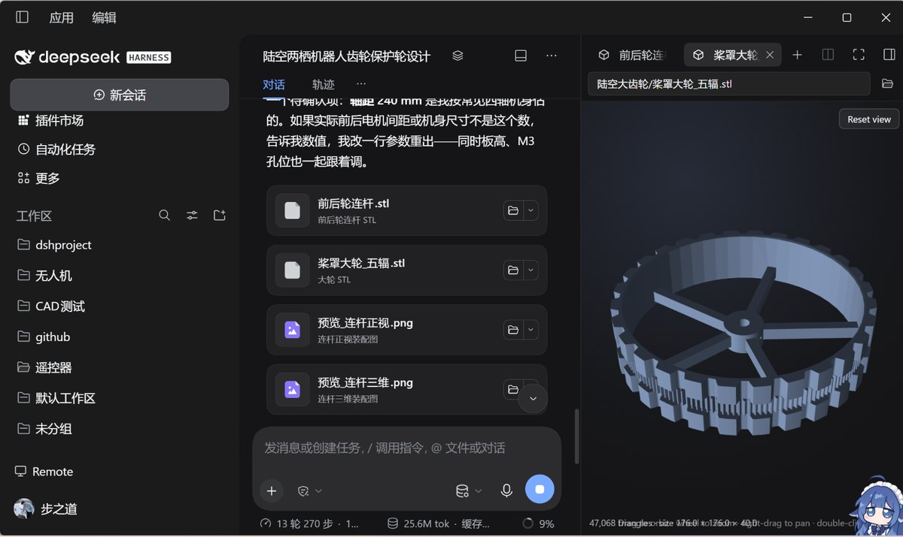
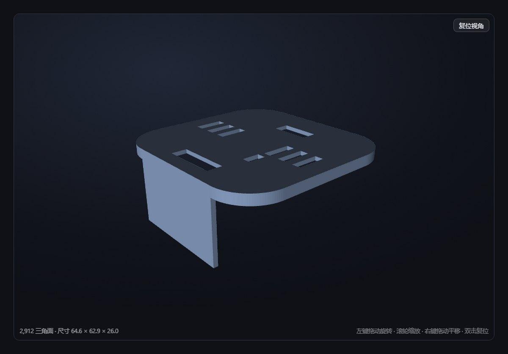
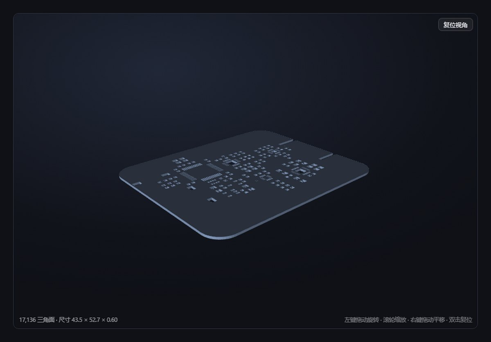

# dsh-stl-viewer

An **STL 3D preview** for the [DeepSeek Harness](https://github.com/deepseek-ai/dsh) side card.
Click any `.stl` in the [dsh-better-sidebar](https://github.com/H-h-Hh/dsh-better-sidebar) file tree
and the file renders in place, with the controls of a normal 3D viewer.

```
left-drag     orbit around the model
wheel         zoom
right-drag    pan (Shift + left-drag does the same; two-finger scroll zooms)
double-click  reset the view (the 复位视角 button and the R / 0 keys do too)
```

<p align="center">
  
</p>

<p align="center"><sub>A 47,068-triangle gear cover (176 × 176 × 40 mm) in the real side card, next to the chat that produced it.</sub></p>

<p align="center">
  
  
</p>

<p align="center"><sub>No viewer installed: “此文件类型不支持预览 / 下载查看”. With the plugin: a 2,912-triangle enclosure lid and a 17,136-triangle stencil, both in the side card.</sub></p>

> **Why a separate plugin?**
> DeepSeek Harness ships previews for text, images, PDFs and Markdown. Binary CAD
> formats such as `.stl`, `.obj`, `.step` fall through to “this file type cannot be
> previewed”. This plugin registers an `stl` file viewer on the `betterSidebar`
> service, so `.stl` stops being an opaque blob.

## Features

- **Binary and ASCII STL** — sniffed, not guessed from the extension: exact `84 + 50·N`
  size match first, then an ASCII scan, then a tolerant binary pass for files with
  trailing bytes
- **Correct normals** — recomputed per facet; STLs in the wild carry zeroed or
  plainly wrong normals, and exported meshes often mix winding orders
- **Two-sided shading** — `gl_FrontFacing` flips the normal, so inverted facets still read
  as solid rather than a black hole
- **Z-up → Y-up** — CAD and 3D printing export Z-up; the viewer stands models upright
  instead of showing them lying on their back
- **Frame-fit camera** — the orbit distance is derived from the bounding sphere and the
  FOV, so a 0.6 mm thick stencil and a 300 mm part both fill the panel on open
- **Themed** — transparent clear colour and `currentColor` chrome, so the panel follows
  the app's dark/light theme instead of stamping a white box on it
- **No build step, no dependencies** — `lib/client.js` *is* the artifact

## Requirements

- DeepSeek Harness `>= 0.2.0`
- [dsh-better-sidebar](https://github.com/H-h-Hh/dsh-better-sidebar) `>= 0.30.0` — it owns
  the file tree, the tabs and the `betterSidebar` service this plugin registers into
- A browser with WebGL 1 (everything current; the software rasteriser is enough)

## Install

In DSH, or from the plugin manager page → *install from a local directory*:

```
plugin_manager install_bundle  target: file:D:/path/to/dsh-stl-viewer
```

Then reload the page. Open any `.stl` from the file tree; if the file is already open in
a tab as an unsupported binary, close that tab and click the file again.

Uninstall:

```
plugin_manager remove_bundle  target: dsh-stl-viewer
```

## How it works

The plugin is a bundle with a host half and a client half.

| half | file | what it does |
| --- | --- | --- |
| host | `lib/index.js` | an empty Cordis plugin — it exists so the package enters the layer stack and its client script is served |
| manifest | `package.json` | `dsh.bundle.patch` makes it a bundle, `exports["./client"]` + `dsh.client.platform: "web"` publish `/plugins/dsh-stl-viewer/client.js` |
| patch | `cordis.patch.yml` | the one `insert:` line that puts the plugin in the layer stack |
| client | `lib/client.js` | parse → normalise → WebGL → input → registration; a classic script, run by the DSH module loader, `require('react')` resolving to the host's React |

Registration is one call, and the model bytes come from the sidebar's own route:

```js
ctx.betterSidebar.registerFileViewer({
  id: 'dsh-stl-viewer:stl',
  title: () => t('title'),
  icon: (size) => cubeIcon(size),
  exts: ['stl'],
  priority: 10,
  fetchStrategy: 'mediaUrl',   // the host hands over the raw-bytes URL
  component: StlViewer
})
```

`fetchStrategy: 'mediaUrl'` means the viewer gets `mediaUrl` as a prop and does a plain
`fetch()`, so no host RPC, no base64 over the wire. Everything after that is local:

| step | detail |
| --- | --- |
| read | `fetch(mediaUrl, { credentials: 'same-origin' })` → `ArrayBuffer` |
| parse | 80-byte header + `uint32` count + 50 bytes/facet, or `vertex x y z` triples (ASCII capped at 6 M numbers) |
| normalise | centre on the bbox, scale to a max edge of 2, per-facet normals, Z-up → Y-up |
| render | WebGL 1, three lights + specular, one `drawArrays`, redraws only on demand |

The plugin also registers a cube file icon for `.stl`, so the file tree stops showing a
generic blob.

## Notes and limits

- **Sizes carry no unit.** STL stores bare numbers; the `size X × Y × Z` readout is the
  raw bounding box, not mm or inch.
- **Z-up is assumed.** Models authored Y-up will lie on their side. Axis guessing is
  deliberately left out — a wrong guess is more confusing than a predictable default.
- **Large files are parsed whole.** A few hundred thousand facets take 1–2 s and one
  `drawArrays` call; there is no streaming and no LOD.
- **STL only.** `.obj`, `.glb`, `.3mf` are out of scope.
- **No WebGL → a message, not a white panel.**

## Tests

```bash
node --check lib/client.js
node test/smoke.cjs
```

`test/smoke.cjs` runs `lib/client.js` in a `vm` sandbox with a minimal React hooks stub and
a replaceable `fetch`, and asserts the module contract, the viewer descriptor, a
hand-built binary cube (12 facets, size 20), an ASCII single triangle, and the three
error paths (garbage bytes, empty file, failed fetch). No browser needed. `.github/workflows/test.yml` runs the same on every push.

The end-to-end check uses a real renderer: `test/harness.html` mounts the component with
React UMD builds, `test/shoot.cjs` screenshots it through a headless Electron
(`--enable-unsafe-swiftshader --use-gl=swiftshader`). That is how the two images above
were produced.

## 中文速览

给 DSH 侧边栏加一个 **STL 三维预览**：文件树里点开 `.stl`，右侧面板直接渲染，交互同常规 3D 看图。

```bash
plugin_manager install_bundle  target: file:D:/path/to/dsh-stl-viewer
```

- 左键旋转 / 滚轮缩放 / 右键平移 / 双击复位（`R`、`0` 也复位）
- 二进制与 ASCII STL 都能读；法线逐面重算、双面打光，Z-up 自动立起来
- 相机按包围球自适应，0.6 mm 的钢网和 300 mm 的零件都会铺满面板
- 依赖 dsh-better-sidebar ≥ 0.30.0；没有构建步骤，`lib/client.js` 就是产物

尺寸没有单位（STL 不存单位），大文件整体解析（几十万面约 1–2 秒），`.obj/.glb/.3mf` 不在范围内。

## License

MIT — see [LICENSE](LICENSE).
